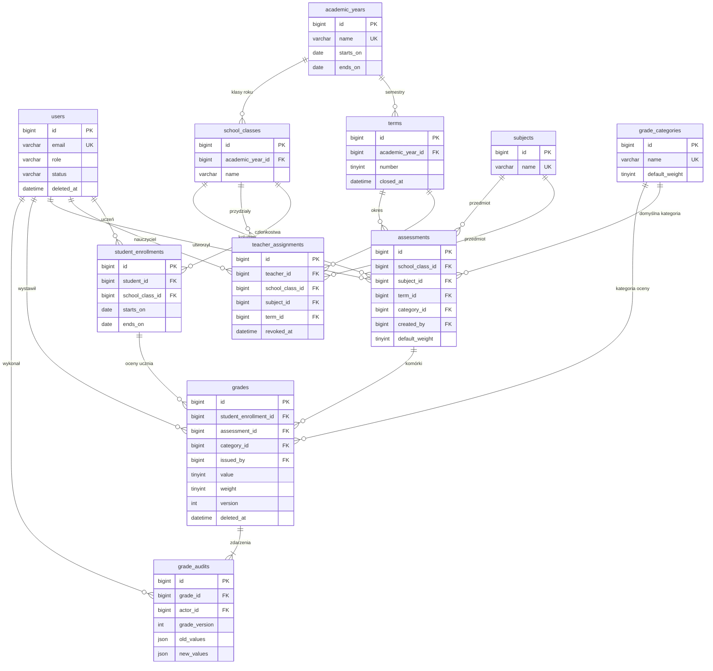

# ERD

PLANNED. Diagram pokazuje wszystkie relacje domenowe; pełne pola, indeksy i reguły przekrojowe są w [SCHEMA](SCHEMA.md). Wszystkie FK są NOT NULL i RESTRICT; soft delete nie usuwa relacji. Tabele sessions/cache/migrations/domain_locks są techniczne, nie częścią grafu ocen.

Krotność grade→audit minimum 1 jest invariantem usługi transakcyjnej, nie wymuszeniem zwykłego FK. Unikalności wielokolumnowe, np. enrollment+assessment, są opisane w SCHEMA, a nie sugerowane oddzielnym UK każdej kolumny diagramu.
